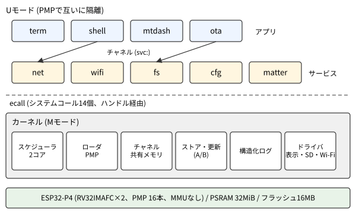
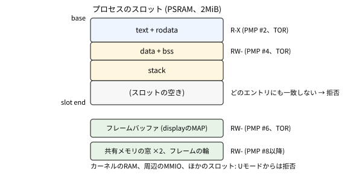

---
figureTitle:  "図"
tableTitle:   "表"
listingTitle: "リスト"
figPrefix:    "図"
tblPrefix:    "表"
lstPrefix:    "リスト"
...

# MMUのないマイコンで動く自作OS {lead="ESP32-P4のPMPと署名で、アプリを互いに守り、安全に更新できるマイクロカーネルをRustで作る" tag="使用ボード: M5Stack Tab5"}

マイコンのファームウェアは、ふつう1つのプログラムで全部の機能をまかないます。
機能が増えると、どこか1か所の不具合で全体が止まったり、ネットワーク越しに入ったデータで別の機能のメモリが壊されたりする心配が出てきます。
本章では、M5Stack Tab5に載っているESP32-P4の上に、アプリを互いに隔離して動かす自作のOS **tab5-os** を作った記録を紹介します。

ESP32-P4にはMMUがありません。
それでもRISC-Vの特権モードとPMPを使えば、アプリが他のアプリやOSのメモリに触れないようにできます。
tab5-osはこの仕組みの上に、プロセス、システムコール、プロセス間通信、署名によるアプリの権限、アプリとOS自身の更新を、すべてRustで実装しています。

{#fig:os_overview}

| 項目                 | 値                                                    | 備考                                   |
| :------------------- | :---------------------------------------------------- | :------------------------------------- |
| ボード               | M5Stack Tab5                                          | ESP32-P4 リビジョンv1.0                |
| CPU                  | RISC-V RV32IMAFC、2コア、360MHz                       | MモードとUモードだけ。MMUなし          |
| メモリ               | 内蔵SRAM 768KiB、PSRAM 32MiB、フラッシュ16MB          | アプリはPSRAMで動く                    |
| カーネル             | Rust、no_std、Mモード                                 | 像の大きさ約240KB                      |
| アプリ               | Rust、Uモード、静的PIE                                | 最大12個を同時に                       |
| 隔離                 | PMP (16エントリ)                                      | 1プロセスにTOR 3本が基本               |
| システムコール       | 14個                                                  | デバイスもサービスもハンドルで扱う     |
| プロセス間通信       | チャネル、サービス、共有メモリ                        | 1通256バイト                           |
| 権限                 | アプリの像をEd25519で署名し、許可を名乗る             | システムの鍵とアプリの鍵               |
| 更新                 | カーネルとアプリのA/B、OTA                            | 失敗したら前の版に戻る                 |
| ログ                 | 構造化ログ (値だけを送り、形式はELFに置く)            | テキストのログは使わない               |
| 検証                 | 自作エミュレータt5emuで実機用のカーネルを無改造で実行 | 試験39本                               |

: tab5-osの仕様 {#tbl:os_spec}

[@fig:os_overview] にtab5-osの全体像を示します。
カーネルはMモードで動き、スケジューラ、アプリのローダ、プロセス間通信、更新、ログと、表示やSDカードなどのドライバを持ちます。
ネットワーク、ファイル、設定、Matterといった機能は、Uモードで動く **サービス** というプロセスが提供します。
ユーザーが使うアプリも同じくUモードのプロセスで、サービスとはチャネルでつながります。

本章の前半では、ESP32-P4でプロセスを隔離するための基礎を説明します。
続いて、プロセスとメモリ、スケジューラ、システムコール、プロセス間通信、権限、更新の順に、tab5-osの設計を説明します。
後半では、検証の方法と、実機で見つかった不具合、性能、残っている課題を紹介します。

## 隔離の基礎

### 特権モード

RISC-VのCPUは、実行中のプログラムがどの **特権モード** にいるかを覚えています。
ESP32-P4のメインのコア (HPコア) が持つのは、最も強い **Mモード** (マシン・モード) と、最も弱い **Uモード** (ユーザー・モード) の2つです。
パソコンのCPUにあるSモード (OSのカーネル用) と、それが使う仮想記憶のMMUはありません。

Mモードはすべてのメモリと周辺回路に触れます。
Uモードは、次の項で説明するPMPが許した範囲にしか触れません。
tab5-osではカーネルをMモード、アプリとサービスをUモードで動かします。

UモードからMモードへ移るのは、例外か割り込みが起きたときだけです。
アプリがカーネルに仕事を頼むときは、**ecall** 命令でわざと例外を起こします。
これが **システムコール** です。
カーネルは処理を終えると **mret** 命令でUモードに戻ります。

### PMP

**PMP** (Physical Memory Protection) は、物理アドレスの範囲ごとに、読み・書き・実行の可否を決める仕組みです。
ESP32-P4 v1.xのPMPには16個のエントリがあり、範囲の粒度は128バイトです。
範囲の指定には、前のエントリのアドレスから自分のアドレスまでを表す **TOR** と、2のべき乗の大きさの範囲を表す **NAPOT** が使えます。

Uモードのアクセスは、どのエントリにも一致しなければ拒否されます。
一方、Mモードのアクセスは、ロックしていないエントリの影響を受けません。
そのためカーネルはPMPのエントリを自分のためには使わず、全部をアプリのために使えます。

MMUがないので、仮想記憶はありません。
アプリが見るアドレスは物理アドレスそのものです。
アプリを別々の場所に置き、PMPでその範囲だけを許すことで、互いのメモリを守ります。

### ブートの流れ

電源を入れると、チップのROMがフラッシュからESP-IDFの **2nd stage bootloader** を読み込みます。
ブートローダは、パーティション・テーブルとotadataという管理領域を見て、2つあるカーネルの置き場所 (スロット) のどちらかを選び、起動します。
tab5-osはこのブートローダの設定を変えて使い、カーネルのA/B更新とロールバックの仕組みもそのまま借りています。
ブートローダの設定を変えた理由は、後述する不具合の節で説明します。

## プロセスとメモリ

### アプリの形式

アプリは、Rustで書いて **静的PIE** (位置独立の実行形式) としてビルドします。
静的PIEは、どのアドレスに置いても、再配置の情報に従って一部の値を書き換えれば動く実行形式です。
tab5-osのアプリが使う再配置は、置いた先頭アドレスを足すだけのR_RISCV_RELATIVEの1種類です。

ホスト側のツールelf2t5aが、ELFを独自の形式 **T5A** に変換し、署名します。
T5Aには、イメージ本体、再配置の表、名前と版、使う権限の一覧 (後述の許可)、署名が入ります。

### スロットとPMP

カーネルはPSRAMの24MiBをアプリ用に取り、12個の **スロット** に分けます。
1スロットは2MiBです。
アプリを起動すると、カーネルは署名を確かめてから、空いたスロットにイメージをコピーし、再配置を当てて実行します。

{#fig:os_process}

[@fig:os_process] にスロットの中身と、PMPで許す範囲を示します。
text (命令と読み出し専用のデータ) は読みと実行だけ、data・bss・スタックは読みと書きだけを許します。
どちらもTORで表すので、2つの範囲に3本のエントリを使います。
データ領域を実行したり、自分の命令を書き換えたりしようとすると、例外になってカーネルがそのプロセスを止めます。

フレームバッファや共有メモリのように、カーネルがアプリに貸すメモリは、残りのエントリで1つずつ許します。
コンテキスト・スイッチでは、プロセスごとに計算しておいたPMPの値を書き込むだけです。
PSRAMを見せる外部メモリのマップは、ブートの時に一度だけ張り、それ以降は張り替えません。

### フラッシュから直接動くアプリ

日本語フォントのように大きなデータを持つアプリは、PSRAMへコピーせず、フラッシュに置いたまま実行 (XIP) できます。
カーネルは外部メモリのマップでフラッシュの該当部分を見せ、その範囲にPMPで読みと実行を許します。
後述の更新の仕組みは、動いているXIPのアプリの領域を上書きしないように気をつけています。

## スケジューラ

### 時分割と2つのコア

カーネルはSYSTIMERというタイマのアラームで、10msごとにプロセスを切り替えます。
プロセスがシステムコールで待つ間 (イベント待ちやスリープ) は、他のプロセスを動かします。
動かすものがなければ、コアをwfi命令で休ませます。

ESP32-P4の2つのコアは、どちらもプロセスを動かします。
カーネルの中に入るときは、両方のコアで共有する大きなロックを1つ取ります。
ロックを細かく分けないのは、カーネルの処理が短く、正しさを保ちやすいからです。

### CPUの取り分

tab5-osは簡易ルーターとしても使うので、ネットワークの処理がアプリに押し負けては困ります。
そこでQNXのadaptive partitioningにならい、プロセスを3つの **パーティション** に分けました。
[@tbl:os_partitions] に取り分を示します。

| パーティション | 取り分 | 入るもの                                   |
| :------------- | :----- | :----------------------------------------- |
| system         | 30%    | システムの鍵で署名したサービスとアプリ     |
| net            | 40%    | ネットワークの経路 (net、wifi)             |
| apps           | 30%    | アプリの鍵で署名したアプリ                 |

: CPUのパーティション {#tbl:os_partitions}

取り分は100msの窓で数え、取り合いになったときだけ効きます。
誰も使わない分は、他のパーティションが使えます。

## システムコールとハンドル

### 14個のシステムコール

tab5-osのシステムコールは、[@tbl:os_syscalls] の14個だけです。
引数はa0〜a5のレジスタ、番号はa7で渡し、結果はa0 (状態) とa1〜a3 (値) で返します。

| 分類         | システムコール                                    |
| :----------- | :------------------------------------------------ |
| プロセス     | EXIT、YIELD、SLEEP、SYS_INFO、TIME                |
| ログ         | LOG_EMIT、LOG_LEVEL                               |
| 権限         | PERMIT_DROP                                       |
| ハンドル     | OPEN、CLOSE、READ、WRITE、CTL、WAIT               |

: システムコールの一覧 {#tbl:os_syscalls}

数が少ないのは、デバイスもサービスもタイマも、すべて **ハンドル** を通して扱うからです。
アプリは名前で **オブジェクト** を開き (OPEN)、返ってきたハンドルに対して読み書き (READ、WRITE) や制御 (CTL) をします。
たとえば画面は `display`、タッチ・パネルは `touch`、他のプロセスのサービスへの接続は `svc:net` のような名前です。

### 待つのは1か所

イベントを待つWAITは、最大16個のハンドルをまとめて待ちます。
タイマが切れた、チャネルにメッセージが来た、画面の1フレームを送り終えた、といった出来事は、どれもハンドルのイベントとして返ります。
アプリは「何かが起きるまでWAITで眠り、起きたら処理する」という1つのループで書けます。

[@lst:os_paint] に、触った所に四角を描くアプリpaintのループを示します (一部を省略しています)。
`Display` と `Touch` は、アプリのランタイムが用意する、画面とタッチ・パネルのハンドルの薄い包みです。

```{#lst:os_paint .rust caption="アプリpaintのイベント・ループ (user/apps/paint/src/main.rs を簡略化)"}
let mut d = Display::open()?;            // 画面を開き、フレームバッファを写像する
let t = Touch::open()?;                  // タッチ・パネルを開く
loop {
    // タッチ (0番) と画面 (1番) のどちらかに出来事があるまで眠る
    let ev = wait(&[&t.0, &d.handle], FOREVER)?;
    if ev.index == 1 {
        // 画面: 前に戻ってきた。絵が消えていれば描き直す
        if ev.kind == display::SHOWN && ev.value == 1 {
            frame(&mut d)?;
        }
        continue;
    }
    // タッチ: 触っている点ごとに四角を描き、その行を表示に反映する
    let n = t.points(&mut pts)?;
    for p in &pts[..n] {
        d.rect(p.x as usize, p.y as usize, SQUARE, SQUARE, color(p.id));
        d.flush(rows_of(p))?;
    }
}
```

画面のイベントSHOWNは、後述する画面の席の仕組みが、アプリが前に戻ったことを知らせるものです。

1つのプロセスが持てるハンドルは16個です。
ハンドルにはオブジェクトごとに決まった権利 (読み、書き、制御、待ち) が付き、権利のない操作は断られます。

## プロセス間通信

### チャネル

**チャネル** は、2つのプロセスをつなぐメッセージの通り道です。
1通は最大256バイトで、片側に4通まで溜まります。
相手のキューが一杯なら、書く側は空くのを待ちます。
相手が閉じると、残りのメッセージを読み終えた後に「相手が閉じた」イベントが届きます。

### サービス

ネットワークやファイルのような機能は、サービスのプロセスが提供します。
サービスは `listen:net` のような名前で待ち受け、アプリは `svc:net` を開いてつなぎます。
つなぐたびに、そのアプリ専用のチャネルが1本できます。

サービスは、つないできた相手がどのアプリかをカーネルに聞けます (相手のプロセス番号、名前、許可)。
これを使って、サービス自身がアプリごとに許すことを決めます。
詳しくは次の節で説明します。

### 共有メモリ

チャネルの256バイトでは、ファイルの中身やネットワークのパケットを運ぶには小さすぎます。
大きなデータは **共有メモリ** で渡します。
サービスはカーネルから共有メモリを取り、その一部を切り出してアプリに渡します。
アプリはそれを自分のアドレス空間に写像 (PMPのエントリを1つ使う) して直接読み書きします。

たとえばファイルのサービスfsは、アプリごとに64KiBを渡し、ファイルの中身とディレクトリの一覧をそこに置きます。
チャネルには「どのファイルの何バイト目から何バイト」という要求と、その結果だけを流します。

## 権限

### 署名と許可

アプリが何を開けるかは、アプリの像に書いた **許可** (Permissions) で決まります。
許可は `display`、`kbd`、`svc:net` のような、開くオブジェクトの名前の一覧です。
アプリは許可にない名前を開けません。

許可は署名の対象に入っているので、像を書き換えて許可を足すことはできません。
署名は **Ed25519** で、カーネルは公開鍵をビルド時に埋め込みます。
鍵は2種類あり、**システムの鍵** で署名した像はすべての許可を名乗れますが、**アプリの鍵** の像は一部の許可を名乗れません。

アプリの鍵では名乗れない許可を **強い許可** と呼びます。
[@tbl:os_strong] に例を示します。

| 強い許可                 | できること                                          |
| :----------------------- | :-------------------------------------------------- |
| `listen:*`               | サービスとして待ち受ける                            |
| `sd`、`netdev:*`         | SDカードやネットワーク・デバイスを直接触る          |
| `kbd`                    | キーボードを読む                                    |
| `proc:spawn`、`proc:kill`| どのアプリでも起動・停止する                        |
| `update`                 | アプリやカーネルを更新する                          |

: 強い許可の例 {#tbl:os_strong}

たとえばキーボードを強い許可にしたのは、どのアプリでもキーを読めるとパスワードを盗まれるからです。

### サービスのgrant

サービスへの許可には、さらに細かい **grant** を付けられます。
たとえば `svc:fs/rw:DATA` は「ファイルのサービスで、DATAフォルダの下だけ読み書きできる」という意味です。
`svc:net/tcp-connect` なら、ネットワークのサービスで外へのTCP接続だけが許されます。

grantを確かめるのはサービス自身です。
サービスはカーネルから相手の許可を受け取り、要求のたびにその範囲かを確かめます。
カーネルはgrantの意味を知りません。

### 自分の権限を手放す

起動の後でしか要らない権限は、システムコールPERMIT_DROPで手放せます。
手放した許可は、そのプロセスが終わるまで戻りません。
ただし、すでに開いているハンドルは、それまでの権限のまま使えます。
こうすると、乗っ取られたときの被害を小さくできます。

## 更新

### アプリのストア

アプリは、フラッシュの8MiBの **ストア** に置きます。
ストアは64KiBの **エクステント** に分かれ、どのアプリがどこにあるかを **目録** (カタログ) に書きます。
目録はフラッシュの2つのセクタに交互に書き、新しい方を使います。
書き込みの途中で電源が切れても、古い目録と古いアプリが残ります。

アプリを更新すると、新しい版を空いたエクステントに書き、古い版も **前の版** として残します。
新しい版が一度動いて正常に終わるか2秒動き続けると、**確定** して前の版を消します。
最初の実行で落ちたら、前の版に戻します。

### カーネルのA/B更新

カーネル自身の更新には、ブートローダの2つのスロットを使います。
新しいカーネルの像 (T5Kという形式で、システムの鍵で署名) を動いていない方のスロットに書き、署名と版を確かめてから、otadataで次の起動先にします。

新しいカーネルは「確かめ待ち」の状態で起動し、起動時の自己試験 (後述) が通ったら自分を確定します。
自己試験に落ちるか、確定の前にパニックや固まりがあれば、チップをリセットします。
するとブートローダが前のカーネルに戻します。
版の番号 (secure_version) より古いカーネルは入りません。

### OTA

ここまでの更新は、USBケーブルでつないだPCから行うものでした。
**OTA** (Over The Air) では、機器の上のアプリが自分でネットワークから取ってきて更新します。

更新のサービスotaは、強い許可 `update` を持ち、カーネルの `update` オブジェクトに像を流し込みます。
カーネルはPCから受け取ったときと同じ関数で、署名、ABIの版、secure_versionを確かめます。
像は署名で守られているので、運ぶ経路は暗号化しないHTTPで足ります。
機器の方から取りに行くので、機器に外から入る口を開ける必要もありません。

ネットワークで入れたカーネルは、もう1つ確かめてから確定します。
自己試験は通っても、ネットワークが動かないカーネルを遠くから直す方法はないからです。
新しいカーネルは自己試験の後も確定せず、otaが像を取ってきたサーバに再びつながったと知らせてくるのを300秒待ちます。
来なければ自分を無効にしてリセットし、前のカーネルに戻ります。
サーバのアドレスは、otadataの項目のうちブートローダが使わない欄に書いておきます。

## 構造化ログ

組み込みのログは、ふつう `printf` で文字列を作って流します。
tab5-osは文字列のログを使わず、**構造化ログ** だけを使います。

アプリやカーネルは `event!(Info, "net.link", link = "wlan0", mtu = 1500)` のように、イベントの名前と値を書きます。
送るのはイベントの番号と値の並びだけで、名前や値の型 (スキーマ) はELFの中に置きます。
PCのツールt5logが、ELFからスキーマを取り出して読める形に戻します。
文字列を作らないので、ログの量が多くても遅くなりにくく、PC側で値を機械的に調べられます。

ログはLP SRAMのリング・バッファに溜まり、USBのシリアル、またはデバッガ (RTT) で読み出します。
LP SRAMはリセットしても消えないので、固まってリセットした前回の起動のログも、次の起動で回収できます。

## 画面の席

Tab5には画面が1つしかありません。
複数のアプリが画面を使うときのために、カーネルは画面を開いたプロセスごとに **席** を作り、席ごとに専用のフレームバッファを与えます。
表示するのは前にいる席のフレームバッファだけで、キーボードとタッチも前の席のアプリにだけ届けます。
背後のアプリが、前のアプリへの入力を盗み見ることはできません。

前に出す操作は、キーボードの左Ctrl＋左Alt＋Tabか、画面の左端からのスワイプで、カーネルが直接受けます。
アプリが自分で前に出る道はありません。
フレームバッファは2枚分しかメモリがないので、3つ目からは背後の席のフレームバッファを取り上げて使い回します。
取り上げられたアプリが描こうとすると、カーネルはそのアプリを止め、前に戻ったときに続きから動かします。

## 検証

### 自作エミュレータt5emu

ESP32-P4、それもv1.xを模すエミュレータは、調べた範囲では見つかりませんでした。
そこで、Rustで自作の **t5emu** を作りました。
t5emuは実機用のカーネルとアプリを、1バイトも変えずに動かします。

t5emuは、命令の実行、PMP、割り込み (CLIC)、2つのコア、キャッシュに加え、カーネルが触る周辺回路を模します。
表示 (MIPI-DSI)、タッチ・パネル、キーボード、SDカード、PCとのネットワーク、2D描画のハードウェアなどです。
画面のキャプチャを取って画素の色を確かめることもできます。

キャッシュは、実機と同じく書き戻すまでメモリに反映しないように模しています。
キャッシュの操作を忘れた不具合は、実機では「たまに画面が乱れる」程度にしか見えませんが、t5emuでは確実に再現します。

### 試験

`make test-p4emu` は、t5emuでの試験39本を並列に流します。
アプリの起動と隔離、更新とロールバック、ネットワーク、画面の切り替え、SDカードの長いファイル名、OTAなどを、ログのイベントと画面の画素で確かめます。
このほか、カーネルのアーキテクチャ依存の部分を上流のQEMU (virtボード) で、ロジックをPC上のテストで確かめます。

カーネルは起動のたびに **自己試験** も行います。
わざとカーネルのメモリや他のスロットに触るアプリを動かし、すべて例外で止められることを確かめます。
署名を壊した像や未知の鍵の像が断られることも確かめます。
前述のとおり、カーネルの更新はこの自己試験に通らないと確定しません。

## 実機で見つかった不具合

### ブートローダがUモードに全部を許していた

**症状**: 最初の設計の段階で、ESP-IDFのソースを読んでいて気づきました。
もとのTab5のブートローダのままでは、Uモードからも周辺回路の大半を読み書きできてしまいます。

**原因**: ESP-IDFのブートローダは、設定REGION_PROTECTION_ENABLEが有効だと、PMPのエントリ0、1、2、15を **ロック付き** で設定します。
ロックしたエントリはUモードにも同じ権限を与えるうえ、リセットするまで変えられません。
PMPは番号の小さいエントリから照合するので、カーネルが後から何を書いても、CPUの周辺回路などの範囲をUモードに対して閉じられませんでした。

**対策**: ブートローダを、この設定を無効にして作り直しました。
実機で、起動直後のPMPのエントリがすべて0 (ロックなし) であることと、Uモードから周辺回路、カーネルのメモリ、他のスロットへのアクセスがすべて拒否されることを確かめました。

### デバッガで止めるとプロセスがMモードで動いた

**症状**: Wi-Fiの性能を測っている最中に、ネットワークのサービスnetが「Mモードからのecall」という例外で止まりました。
netは、カーネルがmretでUモードに戻したはずの直後から、Mモードで動いていました。
MモードではPMPが効かないので、隔離が破れていたことになります。

**原因**: 切り分けると、PCのログ・ツールt5logがデバッガ経由でつながっている最中か、その終わりにだけ起きていました。
t5logが使うデバッガのライブラリは、接続の時、8ビットや16ビットのメモリ・アクセスの時、切断の時にコアを止めていました。
カーネルがmretする瞬間に止められて再開すると、プロセスがMモードのまま動き出したと考えています。
なぜそうなるのかまでは確かめていません。

**対策**: t5logはコアを止めずにメモリを読むように直しました (32ビットのアクセスだけを使う、切断の処理を呼ばない)。
カーネルも、mretの前と、プロセスからの例外の直後に、戻り先のモードがUであることを確かめ、違えばそのプロセスを止めて記録するようにしました。
デバッガがなければ起きないので、アプリが自分で起こせる隔離の穴ではないと判断しています。

### アプリのストアが満ちて更新が入らない

**症状**: 全部のアプリを入れ直すたびに、7個ほどが「catalog full」で入らず、古い版のままになりました。
エラーにはならないので、古いアプリのまま試験してしまったこともありました。

**原因**: 目録の1セクタには63個しか書けません。
アプリを更新すると前の版と新しい版の2つを持ち、新しい版は一度動くまで確定しません。
めったに動かさないアプリは2つのまま残り続け、37個ほどのアプリの半分を入れ直すと、63個を超えていました。
さらに、ストアはアプリを動かさないので、空きのエクステントが細切れになっていました。
空きは56個あるのに、続いた空きは最長9個で、15個が要るフォントのアプリが入りませんでした。

**対策**: 目録やエクステントが足りないときは、他のアプリの前の版を外し、その新しい版を確定させるようにしました。
自分で起動しないアプリの前の版から先に外します。
空きの合計は足りるのに続いた空きがないときは、アプリを別の場所に写して、続いた空きを作ります。
写すときは読み返して比べてから目録を書き換えるので、途中で電源が切れても元の場所のアプリが残ります。
動いているXIPのアプリは動かしません。

### OTAのサービスがスタックを溢れさせた

**症状**: エミュレータでネットワーク越しのOTAを試すと、1回目の更新の直後にotaが「命令アクセスの例外」で止まりました。
止まったアドレスは、otaのデータ領域の中でした。

**原因**: HTTPで取ってくる処理で、2KiBの受信の置き場や要求の組み立て用のバッファがスタックに重なり、既定のスタックの大きさを超えていました。
溢れたスタックが戻り先のアドレスを壊し、データ領域に飛んでいました。
PMPがデータ領域の実行を拒否したので、他のプロセスに被害が及ぶ前に止まりました。

**対策**: otaのスタックを24KiBにしました。
試験には、アプリが1つも例外で止まらないことの確かめを足しました。

## 性能とリソース

[@tbl:os_perf] に、実機で測った主な値を示します。

| 項目                                   | 値                    | 条件                                 |
| :------------------------------------- | :-------------------- | :----------------------------------- |
| 画面の更新                             | 約64fps               | 720×1280、RGB565、MIPI-DSI 2レーン   |
| 全画面の塗りつぶし                     | 5.1ms                 | 2D描画のハードウェア (PPA)           |
| 同じことをCPUで                        | 約20ms                |                                      |
| 何もしないときのCPUの待ち              | 99.2%                 | wifi、fs、netが常駐                  |
| 有線LANのTCPエコー                     | 約36Mbps              | ESP32-P4のEVボード【要確認: 掲載可否】 |
| カーネルの更新の書き込み               | 約3.6秒               | 約220KB、PCからUSB経由               |

: 性能 {#tbl:os_perf}

[@tbl:os_memory] に、メモリの使い方を示します。
アプリのコマンドtopで、プロセスごとの使用量と合わせて見られます。

| 領域                 | 大きさ   | 内訳                                                   |
| :------------------- | :------- | :----------------------------------------------------- |
| 内蔵SRAM             | 640KiB   | カーネル約240KiB、スタック192KiB、ネットワークの輪128KiB |
| PSRAM                | 32MiB    | アプリ24MiB (2MiB×12)、共有メモリ4MiB、表示4MiB        |
| フラッシュのストア   | 8MiB     | 64KiB×128エクステント                                  |

: メモリの使い方 {#tbl:os_memory}

## 残っている課題

### 標準入出力

tab5-osには、Linuxのような標準入出力がありません。
アプリの出力はログにしか出ず、シェルから起動したアプリの出力は画面のターミナルに出ません。
起動の時に親がチャネルの端を子に渡す方式を検討していますが、どのハンドルを渡せるかを絞らないと、新しい権限の抜け道になります。

### ドライバの置き場所

今はドライバの多くがカーネルの中にあります。
デバイスを触るロジック (センサーのレジスタの意味など) は、Uモードのサービスに出したほうがカーネルを小さく保てます。
ただし、DMAを使う回路は、メモリのどこにでも書けてしまいます。
ESP32-P4にはDMAの範囲を絞る仕組み (IOMMU) がないので、DMAを使うドライバはカーネルに残すしかありません。

### 自動の更新

OTAは、今は人がシェルのコマンドで頼んだときだけ動きます。
新しい版があるかを定期的に確かめる仕組みと、版を比べるための目録はまだありません。

## おわりに

本章では、MMUのないESP32-P4の上に、RustでマイクロカーネルのOS tab5-osを作りました。
アプリは静的PIEとしてPSRAMのスロットに置き、PMPで自分の範囲だけを許しました。
デバイスもサービスもハンドルで扱うことで、システムコールを14個に抑え、サービスとアプリはチャネルと共有メモリでつなぎました。
アプリの像に署名した許可を持たせ、どのアプリが何を開けるかを決めました。
アプリとカーネルの更新は、どちらも前の版を残し、確かめてから確定するので、失敗しても前の版に戻れます。

MMUがなくても、PMPと署名を組み合わせれば、アプリを互いに守るOSが作れます。
自作のエミュレータで実機用のカーネルをそのまま動かせたことが、こうした仕組みを短い期間で積み上げられた大きな理由でした。
読者がマイコンで複数の機能を安全に動かしたいときの参考になれば幸いです。

## 参考文献

- RISC-V International, "The RISC-V Instruction Set Manual Volume II: Privileged Architecture" 【要確認: 版と日付】
- Espressif Systems, "ESP32-P4 Technical Reference Manual" 【要確認: 版と日付】
- Espressif Systems, ESP-IDF v6.0 (2nd stage bootloader、soc/esp32p4/register/hw_ver1)
- M5Stack, "Tab5" 製品資料 【要確認: 文書名と日付】
- QNX Software Systems, "Adaptive Partitioning" 【要確認: 文書名】
- smoltcp 0.14.0、embedded-sdmmc 0.10.0、ed25519-compact 2.6

## ソースコード

本章のソースコードはtab5-osリポジトリの次のディレクトリにあります。

| ディレクトリ | 内容                                                       |
| :----------- | :--------------------------------------------------------- |
| kernel       | カーネル (スケジューラ、ローダ、ハンドル、更新、ドライバ)  |
| abi          | システムコールとオブジェクトの定義 (カーネルとアプリで共有) |
| user/rt      | アプリのランタイム                                         |
| user/apps    | サービスとアプリ (net、fs、cfg、ota、term、shellなど)      |
| emu          | エミュレータt5emu                                          |
| tools        | elf2t5a (像の変換と署名)、t5log (ログと制御)               |
| doc          | 設計と調査の記録 (章ごと)                                  |

: ソースコードの場所 {#tbl:os_source}

<!--
図の状態:
- figure/os_*.svg は figure/gen_os.py で生成 (python3 figure/gen_os.py)
- 内容は plan/os.md の「図の一覧」を参照
-->
